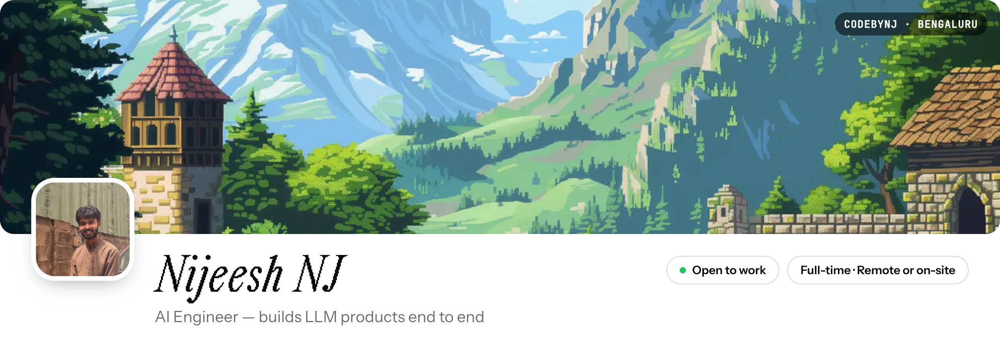
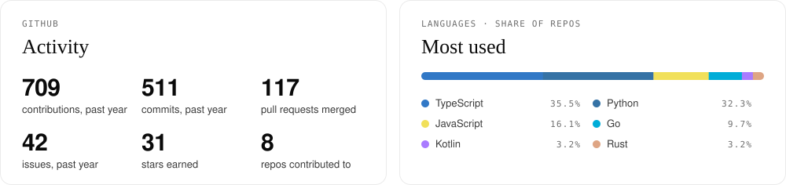
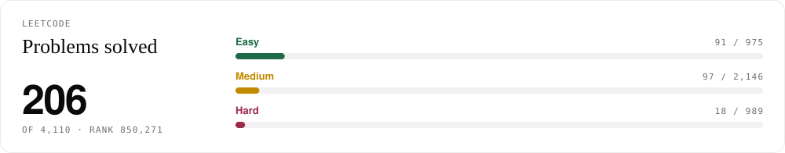
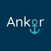
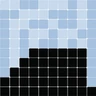

<!-- cards/*.svg are redrawn daily by .github/workflows/cards.yml (scripts/cards.py, scripts/trophy.ts). The snake comes from .github/workflows/snake.yml. -->

<picture>
  <source media="(prefers-color-scheme: dark)" srcset="assets/banner-dark.jpg">
  
</picture>

I'm an engineer who builds with a designer's eye, from model to interface. Final-year CS student ('27), interned at **Ankor** and **Tech Mahindra**.

    

| **3** | **3** | **75+** | **7** |
|:---:|:---:|:---:|:---:|
| internships | production AI products | merged PRs at Ankor | hackathon & open-source results |

### 01 &nbsp;Toolbelt
What I build with.

| | |
|:--|:--|
| **Languages** |        |
| **Web & apps** |         |
| **Infra & cloud** |        |
| **AI** |        |

### 02 &nbsp;GitHub
Redrawn every day from the GitHub API.

<picture>
  <source media="(prefers-color-scheme: dark)" srcset="cards/overview-dark.svg">
  
</picture>
<picture>
  <source media="(prefers-color-scheme: dark)" srcset="cards/trophy-dark.svg">
  
</picture>

### 03 &nbsp;LeetCode
[@Nijeesh_1805](https://leetcode.com/u/Nijeesh_1805/)

<picture>
  <source media="(prefers-color-scheme: dark)" srcset="cards/leetcode-dark.svg">
  
</picture>

### 04 &nbsp;Experience
Newest first.

| | Role | When | What I did |
|:--:|:--|:--|:--|
|  | **AI + Full Stack Developer Intern** Ankor · XAM exam & proctoring platform | Dec '25 – Mar '26 | Core engineer on XAM: 75+ merged PRs, billing, Rust reports |
|  | **AI Engineer Intern** Tech Mahindra · INDUS Project | Oct '25 – Dec '25 | Multilingual OCR, QnA and crawler pipelines for Indian languages |
|  | **AIML Intern** Skill First Labs | Sep '24 – Aug '25 | Shipped three production AI products |

### 05 &nbsp;Achievements
A few hackathons and open source.

| | Event | Host | Result |
|:--:|:--|:--|:--|
|  | UI/UX Revamping Competition | IIT Patna | 🏆 **Winner** |
|  | Machine Learning Hackathon | NIT Trichy | 🥈 **Runner-up** |
|  | Generative AI Buildathon | 100x Engineers | 🎯 Finalist |
|  | AI Ascend Hackathon | AWS | 🎯 Finalist |
|  | GRASP Hackathon | ASME | 🎯 Finalist |
|  | Smart Transit Challenge | Toyota Mobility Foundation | 🤝 Contributor |
|  | Mesa, agent-based modeling | Open source | 🤝 Contributor |

&nbsp;

